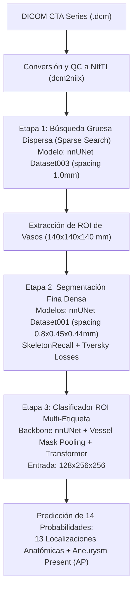

# Guía de Réplica y Benchmark: Solución Ganadora (1er Lugar) RSNA 2025 Brain Aneurysm Detection

Esta guía describe cómo utilizar y ejecutar el benchmark de la solución ganadora del desafío **RSNA Intracranial Aneurysm Detection AI Challenge** desarrollada por **tomoon33 (uchiyama33)**.

---

## 1. Arquitectura de la Solución (tomoon33)

El pipeline ganador se basa en un enfoque de dos fases **Coarse-to-Fine (Grueso a Fino)** guiado por segmentación vascular:



### Las 14 Clases de Salida:
1. `Aneurysm Present` (Presencia global de aneurisma)
2. `Left Infraclinoid Internal Carotid Artery`
3. `Right Infraclinoid Internal Carotid Artery`
4. `Left Supraclinoid Internal Carotid Artery`
5. `Right Supraclinoid Internal Carotid Artery`
6. `Left Middle Cerebral Artery`
7. `Right Middle Cerebral Artery`
8. `Anterior Communicating Artery`
9. `Left Anterior Cerebral Artery`
10. `Right Anterior Cerebral Artery`
11. `Left Posterior Communicating Artery`
12. `Right Posterior Communicating Artery`
13. `Basilar Artery`
14. `Vertebrobasilar System`

---

## 2. Organización del Proyecto y Carpetas

El entorno ha sido aislado por completo en este directorio para garantizar que no interfiera con otros proyectos ni con la instalación global de Python en la computadora.

```
rsna2025/
├── .env                       <- Variables de entorno y rutas fijas a los modelos
├── .project-root              <- Indicador de raíz para rootutils
├── requirements.txt           <- Lista de dependencias del entorno
├── run_benchmark.py           <- Script unificado para ejecutar el benchmark/inferencia
│
├── .venv/                     <- Entorno virtual aislado (Python 3.12 + PyTorch CUDA 12.8)
├── bin/                       <- Binarios Windows nativos (dcm2niix.exe y DLLs de soporte)
│
├── data/                      <- Directorio principal de datos
│   ├── series/                <- [ENTRADA] Coloca aquí tus carpetas DICOM
│   │   ├── <SeriesInstanceUID_1>/
│   │   │   ├── 1.dcm
│   │   │   └── 2.dcm
│   │   └── <SeriesInstanceUID_2>/
│   │       └── *.dcm
│   ├── series_niix/           <- Volúmenes NIfTI convertidos y estandarizados
│   ├── segmentations/         <- Máscaras de segmentación ground-truth (opcional)
│   ├── train.csv              <- Etiquetas de entrenamiento (opcional para evaluación)
│   ├── train_localizers.csv   <- Coordenadas de aneurismas (opcional)
│   └── nnUNet/
│       ├── raw/               <- Datos crudos para nnU-Net
│       └── preprocessed/      <- Planes y datos preprocesados de nnU-Net
│
├── logs/                      <- Pesos de los modelos descargados y organizados
│   ├── nnUNet_results/
│   │   ├── Dataset001_VesselSegmentation/
│   │   │   ├── nnUNetTrainerSkeletonRecall_more_DAv3_ep800__nnUNetResEncUNetMPlans__3d_fullres/
│   │   │   ├── RSNA2025Trainer_moreDAv6_SkeletonRecallW3TverskyBeta07__nnUNetResEncUNetMPlans__3d_fullres/
│   │   │   └── RSNA2025Trainer_moreDAv6_1_SkeletonRecallTverskyBeta07__nnUNetResEncUNetMPlans__3d_fullres/
│   │   └── Dataset003_VesselGrouping/
│   │       └── RSNA2025Trainer_moreDAv7__nnUNetResEncUNetMPlans__3d_fullres/
│   └── train/runs/
│       └── 251013-seg_tf-v4-nnunet_truncate1_preV6_1-ex_dav6w3-m32g64-e25-w01_005_1-s128_256_256/
│           └── checkpoints/   <- Folds 0, 1, 2, 3 y 4 (last.ckpt y epoch_*.ckpt)
│
├── configs/                   <- Configuraciones Hydra del modelo de clasificación
├── scripts/                   <- Scripts oficiales del autor (rsna_submission_roi.py, etc.)
└── src/                       <- Módulos fuente del modelo (redes, datasets, transformaciones)
```

---

## 3. Activación del Entorno Virtual (.venv)

Abre una terminal de PowerShell dentro de esta carpeta (`d:\archivos a drapp\neuromi2\aneurism cta\rsna2025`) y activa el entorno:

```powershell
.\.venv\Scripts\Activate.ps1
```

O en el símbolo del sistema clásico (CMD):
```cmd
.venv\Scripts\activate.bat
```

> **GPU Habilitada**: El entorno cuenta con PyTorch nightly con CUDA 12.8, completamente optimizado para tu tarjeta gráfica **NVIDIA GeForce RTX 5070 Ti (16 GB, arquitectura Blackwell sm_120)**.

---

## 4. Cómo Ejecutar el Benchmark

### A) Ejecución Automática sobre Múltiples Series
Coloca las carpetas con estudios DICOM dentro de `data/series/`:

```
data/series/
  ├── caso_paciente_01/
  │     ├── archivo1.dcm
  │     └── archivo2.dcm
  └── caso_paciente_02/
        └── ...
```

Luego ejecuta el benchmark:
```powershell
python run_benchmark.py
```

### B) Evaluar una Sola Serie o Carpeta Específica
Si deseas probar directamente una carpeta DICOM externa sin moverla:

```powershell
python run_benchmark.py --series-path "D:/ruta/a/mi/estudio_dicom"
```

### C) Limitar la Cantidad de Casos
Para hacer una prueba rápida de los primeros 5 casos:
```powershell
python run_benchmark.py --max-series 5 --output benchmark_rapido.csv
```

---

## 5. Salidas del Benchmark

Al finalizar la ejecución, el script genera:
1. **Archivo CSV**: `benchmark_results.csv` con las probabilidades predichas para cada una de las 14 clases y el tiempo de inferencia por estudio.
2. **Archivo Parquet**: `benchmark_results.parquet` para análisis de alta velocidad.
3. **Métricas en Consola**:
   - Tiempo total transcurrido.
   - Latencia promedio por serie (segundos / estudio).
   - Rendimiento (Throughput en series por segundo).
   - Probabilidad estimada de aneurisma (`P(Aneurysm Present)`).

---

## 6. Configuración de Parámetros (.env)

El archivo `.env` ya se encuentra configurado con los parámetros óptimos del autor ganador:
- `VESSEL_DEVICE="cuda:0"`: Ejecuta la inferencia en GPU.
- `ROI_FOLDS="0,1,2,3"`: Ensemble de los 4 mejores pliegues de validación cruzada.
- `ROI_TTA="2"`: Test-Time Augmentation (2 pasadas para mayor precisión).
- `VESSEL_REFINE_MARGIN_Z="15"` y `VESSEL_REFINE_MARGIN_XY="30"`: Márgenes de seguridad para el recorte de ROI.
- `RSNA_ERROR_FALLBACK_PROBS`: Probabilidades a priori que se asignan en caso de fallo crítico en el archivo DICOM o artefactos severos.
